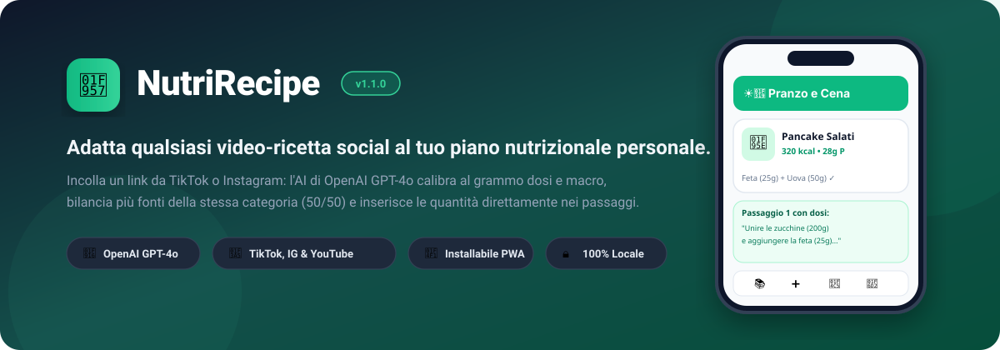
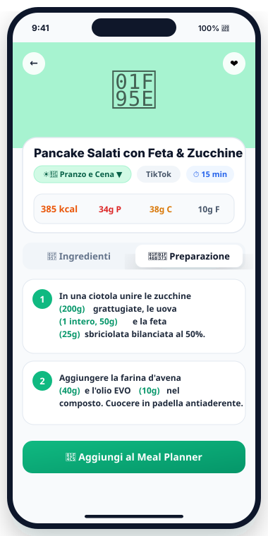
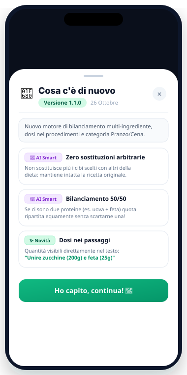
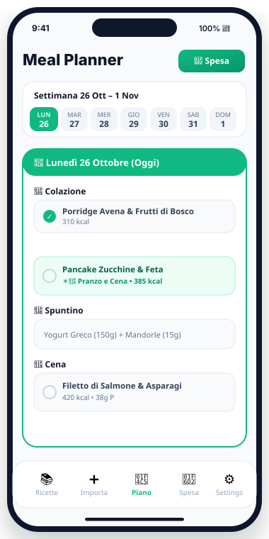

  

  
  
  
  

---

## 🥗 Cos'è NutriRecipe?

Quante volte hai visto una ricetta sfiziosa su **TikTok** o **Instagram**, ma non sapevi quali grammature utilizzare per non sgarrare il tuo piano nutrizionale?

**NutriRecipe** è una Progressive Web App (PWA) intelligente che trasforma qualsiasi video-ricetta social nel tuo pasto bilanciato su misura. Incolla il link del reel o video: l'intelligenza artificiale (**OpenAI GPT-4o**) estrae gli ingredienti e **calibra le dosi al grammo sulla tua scheda nutrizionale**, preservando il gusto e la consistenza della ricetta originale.

---

## 📱 Schermate dell'Applicazione

  <table border="0">
    <tr>
      <td width="33%" align="center">
        <b>👨‍🍳 Dosi nei Passaggi &amp; 50/50</b>
      </td>
      <td width="33%" align="center">
        <b>🚀 Notifiche Aggiornamenti &amp; Changelog</b>
      </td>
      <td width="33%" align="center">
        <b>📅 Meal Planner &amp; Lista Spesa</b>
      </td>
    </tr>
    <tr>
      <td valign="top">
        
      </td>
      <td valign="top">
        
      </td>
      <td valign="top">
        
      </td>
    </tr>
    <tr>
      <td align="center">
        <small>Dosi indicate direttamente in ogni passaggio sequenziale <code>(200g)</code>, <code>(25g)</code>.</small>
      </td>
      <td align="center">
        <small>Popup automatico ad ogni rilascio in produzione con lo storico delle novità.</small>
      </td>
      <td align="center">
        <small>Pianifica colazione, pranzo e cena e genera la spesa divisa per corsie.</small>
      </td>
    </tr>
  </table>

---

## ✨ Funzionalità Principali

### 🧠 Motore AI Intelligente (v1.1.0)
- **Zero sostituzioni arbitrarie**: Se la ricetta originale prevede uova e feta greca, l'AI conserva entrambi gli ingredienti (non rimpiazza la feta con petto di pollo solo per variare).
- **Bilanciamento 50/50 multi-ingrediente**: Se la ricetta contiene 2 o più fonti della stessa categoria (es. 2 proteine come uova + tonno, o 2 carboidrati come farina + fiocchi d'avena), la quota del pasto viene divisa equamente tra tutti gli alimenti senza scartarne nessuno.
- **Rapporti tecnici per impasti e pastelle**: Per pancake, torte fitness, crêpes e piadine, scala proporzionalmente farine, liquidi (latte, albume, acqua) e leganti per garantire una consistenza e cottura perfette.
- **Dosi integrate nei procedimenti**: Ogni passaggio sequenziale riporta le quantità esatte tra parentesi tonde: puoi cucinare leggendo la sequenza senza dover cambiare scheda.
- **☀️🌙 Nuova categoria "Pranzo e Cena"**: Salva ricette adatte a entrambi i pasti e visualizzale sia filtrando per Pranzo che per Cena.

### 📅 Pianificazione & Spesa
- **Meal Planner settimanale**: Assegna le ricette salvate ai pasti dal lunedì alla domenica.
- **Lista della spesa automatica**: Genera istantaneamente la lista degli ingredienti necessari aggregati per reparto di supermercato.
- **Lettura PDF del Nutrizionista**: Carica direttamente il PDF della tua dieta: l'AI estrae e configura automaticamente categorie, grammature e opzioni alimentari.

---

## 📲 Installazione come App su iPhone (PWA)

Non serve scaricare l'app da App Store: NutriRecipe è una **PWA nativa**:

1. Apri **[recipenutriz.vercel.app](https://recipenutriz.vercel.app)** in **Safari** su iPhone.
2. Tocca l'icona di sistema **Condividi** (il quadrato con la freccia verso l'alto 􀈂).
3. Scorri verso il basso e tocca **"Aggiungi a schermata Home"**.
4. Conferma con **Aggiungi**: l'app sarà disponibile sulla tua Home come un'app nativa a schermo intero!
5. Quando trovi una ricetta su TikTok o Instagram, premi **Condividi** → **NutriRecipe** per importarla con 1 tap.

---

## 🔒 Privacy & Sicurezza dei Dati

- **Archiviazione 100% Locale**: La scheda nutrizionale, le ricette salvate, le note e il meal planner risiedono esclusivamente nel browser del tuo dispositivo (**IndexedDB tramite Dexie.js**). Nessun dato personale viene inviato o memorizzato su database terzi.
- **Architettura Cloud Protetta**: Le richieste AI transitano attraverso una funzione serverless protetta (`/api/ai`), senza esporre chiavi API sul client.

---

## 🛠️ Tech Stack

- **Frontend**: React 18, TypeScript, Tailwind CSS, Vite PWA
- **Database Locale**: IndexedDB con Dexie.js (con reattività `dexie-react-hooks`)
- **Motore AI**: OpenAI GPT-4o (ottimizzato per strutturazione JSON e ragionamento culinario)
- **Scraping Social**: RapidAPI TikTok & Instagram Scraper
- **Deployment**: Vercel Serverless Edge Functions

---

## 📜 Tracciamento Versioni & Changelog

Ogni aggiornamento rilasciato sul branch `main` include le note di rilascio pubblicate nel changelog in-app.  
Gli utenti vengono notificati direttamente all'apertura dell'applicazione con il dettaglio di cosa è cambiato e come testare le nuove funzionalità.

---

  Realizzato con ❤️ per rendere la nutrizione semplice, flessibile e gustosa.

